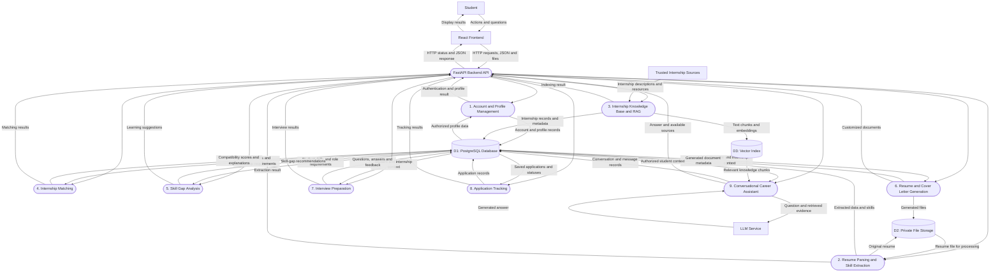

# AI Career Companion — Data Flow Diagram (DFD)

## 1. Purpose

This DFD explains how data flows between the student, React
frontend, FastAPI backend, nine project modules, PostgreSQL,
private file storage, the vector index, and the LLM service.

## 2. Level 1 Data Flow Diagram

## 3. Data Stores

- D1 — PostgreSQL: Stores user accounts, profiles, resume metadata,
  extracted information, skills, internships, matching results,
  recommendations, generated-document metadata, interview records,
  applications, conversations, and messages.

- D2 — Private File Storage: Stores original resumes and generated
  files. PostgreSQL stores their metadata and file locations.

- D3 — Vector Index: Stores searchable text chunks and embeddings
  for Retrieval-Augmented Generation (RAG).
  Implemented (Phase 2) as a FAISS `IndexIDMap2(IndexFlatIP)` file
  rebuilt from PostgreSQL. It stores only vectors keyed by
  `knowledge_documents.document_id`; all text and metadata stay in
  PostgreSQL (D1), which is the source of truth. Embeddings come from
  a local `all-MiniLM-L6-v2` model (384 dimensions, pinned revision).

## 4. Process Summary

1. Account and Profile Management handles account and profile data.
2. Resume Parsing extracts structured information from uploaded resumes.
3. Internship Knowledge Base and RAG prepare and retrieve relevant
   internship and career-resource information.
4. Internship Matching compares student skills with internship
   requirements and calculates compatibility scores.
5. Skill Gap Analysis identifies missing skills and recommends
   learning activities.
6. Document Generation creates customized resumes and cover letters.
7. Interview Preparation manages practice questions, answers, and feedback.
8. Application Tracking manages saved internships and application statuses.
9. Career Assistant retrieves relevant context and asks the LLM to
   generate an evidence-grounded response.

## 5. Security and Design Notes

- Protected endpoints must validate authentication and authorization.
- Students must only access records they are permitted to view.
- Uploaded files must be validated and stored privately.
- Internship-specific answers should use reliable, relevant sources
  where available.
- Internship Matching (P4, Phase 3) combines FAISS nearest neighbours
  with skill-overlap candidates from PostgreSQL, scores each with a
  deterministic, explainable formula (skills 50%, semantic 20%,
  education 15%, location 15%), and stores each request as a run in
  `match_results`. Missing student information is scored
  conservatively and reported, never inflating compatibility.
- Skill Gap Analysis (P5, Phase 4) classifies each internship skill as
  matched, partially matched (curated related skills) or missing,
  prioritises gaps across the latest match run or selected internships
  using importance and the read-only Phase 3 scores, and attaches
  curated, link-free learning plans. Progress is tracked per skill and
  re-parsed resumes complete recommendations automatically.
- Document Generation (P6, Phase 5) builds a fact base with stable ids
  from the student's own resume and profile, produces internship-specific
  resumes and cover letters deterministically, and optionally asks the
  LLM service to rephrase (opt-in per document; contact details never
  sent). Every statement is fact-checked; documents are versioned in D1
  and rendered to DOCX/TXT on download (nothing stored in D2).
- Interview Preparation (P7, Phase 6) builds sessions from a curated
  question bank (all 69 dataset skills), the student's own resume facts
  (project questions cite fact ids) and the internship record; answers
  are scored by deterministic rubrics with optional local semantic
  matching (technical scores are key-point coverage, with curated checks
  for common wrong statements), attempts and summaries are stored in D1,
  and AI feedback is opt-in per answer. Names, contact details, addresses
  and PIN codes are scrubbed, and a final check blocks the request if any
  remain.
- Vector search results are always filtered through PostgreSQL, so
  inactive or deleted internships are never returned, even from an
  outdated index.
- Index rebuilds run one at a time (PostgreSQL advisory lock) and swap
  in atomically; no pickle files are ever loaded.
- This DFD represents the proposed architecture; it does not imply
  that all nine modules have already been implemented.