# System Architecture — RAG-based Internship Matching

This document describes the architecture used for the RAG internship-matching assignment. It is part of the AI Career Companion backend (FastAPI + PostgreSQL), modules 2–4.

## 1. Components

```mermaid
flowchart LR
    R[Resume PDF / DOCX] --> P[Resume parser<br/>pypdf / python-docx]
    P --> N[Skill normalizer<br/>canonical catalog + aliases]
    N --> DB[(PostgreSQL<br/>source of truth)]
    PR[Student profile<br/>degree, location] --> DB

    DS[internships.json<br/>180 synthetic postings] --> V[Dataset validator]
    V --> SEED[Idempotent importer]
    SEED --> DB

    DB --> TXT[Internship text builder]
    TXT --> EMB[Sentence Transformers<br/>all-MiniLM-L6-v2, 384-d]
    EMB --> IDX[(FAISS IndexIDMap2<br/>IndexFlatIP, cosine)]

    DB --> CP[Candidate profile builder]
    CP --> Q[Query text]
    Q --> EMB
    EMB --> RET[Retrieval:<br/>FAISS top-N ∪ shared-skill candidates]
    IDX --> RET
    RET --> CHK[PostgreSQL re-check<br/>active, deadline]
    CHK --> SC[Compatibility scorer v1<br/>skills · semantic · education · location]
    SC --> EXP[Deterministic explanations<br/>from source records]
    EXP --> RUN[(match_results<br/>runs + breakdown)]
    RUN --> API[FastAPI /matches endpoints]
```

| Component | Code | Responsibility |
|---|---|---|
| Resume parser | `backend/services/resume_parser.py` | Extracts summary, skills, education, experience, projects and contact data from PDF/DOCX. |
| Skill normalizer | `backend/services/skill_normalizer.py` | Maps raw skills to canonical names (e.g. `React.js` → `React`, `A WS` → `AWS`); unknown skills kept as `other`. |
| Resume skill store | `backend/services/resume_skills.py` | Links normalized skills to a resume (`resume_skills`), sharing `skills` rows. |
| Dataset validator / importer | `backend/services/internship_seed.py` | Strict schema validation of every record; idempotent import keyed on the dataset ID. |
| Internship text builder | `backend/services/internship_text.py` | Builds the exact text that is embedded (title, company, domain, skills, education, location, description). |
| Embeddings | `backend/services/embeddings.py` | Local Sentence Transformers model, pinned revision, safetensors only, loaded offline and lazily. |
| Vector index | `backend/services/vector_index.py` | Builds/loads the FAISS index from PostgreSQL; atomic swap, SHA-256 verification, advisory lock. |
| Candidate profile | `backend/services/candidate_profile.py` | Combines resume skills with profile degree/location; builds the query text. |
| Compatibility scorer | `backend/services/compatibility.py` | Pure, deterministic scoring and explanation functions (algorithm `v1`). |
| Matching agent | `backend/services/matching_agent.py` | Candidate retrieval, filtering, scoring, ranking and persistence. |
| API | `backend/routes/internships.py`, `backend/routes/matches.py` | Catalog, semantic search, matching runs, history, single-internship score. |
| Evaluation | `evaluation/` | Assignment evaluation runner, synthetic profiles and calibration study. |

## 2. Data stores

| Store | Contents | Notes |
|---|---|---|
| PostgreSQL `internships`, `internship_skills`, `skills` | Internship records and their required/preferred skills | **Single source of truth.** |
| PostgreSQL `knowledge_documents` | One row per indexed internship: the exact embedded text, its hash, model and status | `document_id` is the FAISS vector ID. |
| FAISS index (`FAISS_INDEX_DIR`) | `internships-<build-id>.faiss` + `manifest.json` | Stores **only vectors**; native FAISS format (no pickle); gitignored. |
| PostgreSQL `resumes`, `resume_extractions`, `resume_skills` | Uploaded resumes, parser output history, normalized skills | Extraction history is append-only. |
| PostgreSQL `match_results` | One row per recommended internship per run, with full score breakdown | Runs are kept as history. |

## 3. Retrieval-augmented flow

1. **Index time** — every active internship is rendered to text, embedded with `all-MiniLM-L6-v2` and stored in a FAISS `IndexIDMap2(IndexFlatIP)` with unit-length vectors, so inner product equals cosine similarity.
2. **Query time** — the candidate's normalized skills, degree and summary are rendered to a query text and embedded with the same model.
3. **Retrieve** — FAISS returns the nearest internships (at least 50). Every active internship sharing a skill with the candidate is added, so no skill match is missed because of semantic ranking.
4. **Ground** — each candidate internship is loaded from PostgreSQL and re-checked (active, deadline). Anything not in PostgreSQL is discarded; the index can never introduce a record.
5. **Score and explain** — deterministic scoring; every explanation sentence is built from the retrieved internship record and the candidate's extracted data. No text generation model is used, so no company, requirement or candidate fact can be invented.

## 4. Safety properties

- PostgreSQL is authoritative; stale or tampered index files cannot surface inactive, deleted or unknown internships.
- Index files are verified by SHA-256 against the manifest before loading; the loader accepts only file names it generated.
- No pickle files are downloaded or loaded (model weights are safetensors; index is native FAISS).
- The embedding model is loaded from a local folder with `local_files_only=True` and `trust_remote_code=False`, never at API startup.
- Index rebuilds are serialized by a PostgreSQL advisory lock and swapped in atomically.
- All matching endpoints enforce resume and run ownership.
